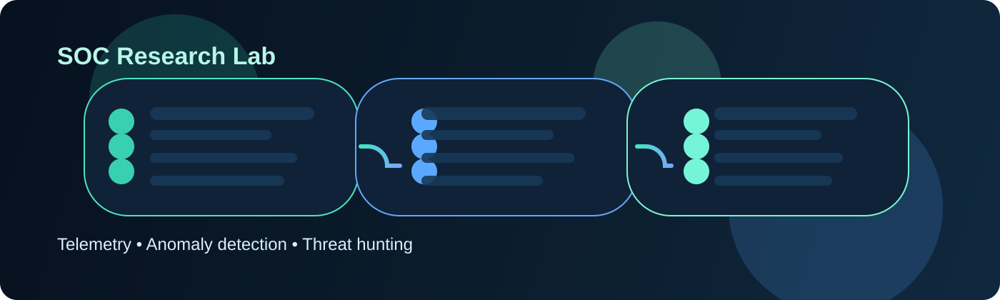

# SOC Research Lab



A research-grade SOC telemetry analysis and anomaly detection project for security operations teams, red-team emulation, and evidence-driven detection engineering.

## What this project does

This repository is designed to help researchers and analysts study security telemetry in a structured, reproducible way. It focuses on:

- endpoint and network telemetry analysis
- anomaly detection for suspicious host behavior
- behavior summarization by host, user, and process
- clear research records for experiments and SOC workflows
- explainable detection logic that can be extended over time

## Why it matters

Modern SOCs generate high-volume, noisy telemetry. Without structure, it is difficult to separate routine activity from meaningful signals. This project creates a lab environment that makes the following easier:

- baseline comparison
- suspicious activity ranking
- dataset validation
- methodology documentation
- repeatable experiments

## Visual overview


## Project layout

- `data/` — sample telemetry and dataset notes
- `docs/` — architecture and methodology guidance
- `research/` — experiment write-ups and findings
- `notebooks/` — exploratory analysis and model iteration
- `scripts/` — runnable examples and operational demos
- `src/soc_research_lab/` — reusable analysis code
- `tests/` — validation and regression checks
- `assets/` — project visuals and diagram assets

## Quick start

```bash
python3 -m venv .venv
source .venv/bin/activate
python -m pip install --upgrade pip
pip install -r requirements.txt
python scripts/run_demo.py
python -m unittest discover -s tests -v
```

## Command line usage

```bash
python -m soc_research_lab.cli --csv data/synthetic_endpoint_telemetry.csv --summary
python -m soc_research_lab.cli --csv data/synthetic_endpoint_telemetry.csv --anomalies --threshold 0.75
```

## Example analytical workflow

1. Load telemetry from CSV or JSON sources
2. Normalize event keys and severity values
3. Summarize activity by host, process, and user
4. Compare activity against a baseline median
5. Surface process and host anomalies with explainable scores
6. Record assumptions, dataset details, and next steps

## Example detections

The current demo can surface:

- hosts with abnormal event volume
- processes with elevated severity patterns
- suspicious user or host activity clusters
- operational baselines for comparing event trends

## Research standards

Every experiment should include:

- research question
- dataset used
- method or algorithm
- thresholds and metrics
- assumptions
- validation result
- next steps

## License

This project is licensed under the MIT License.
